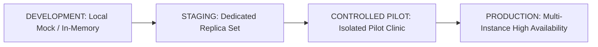

# TriMedi Controlled Clinic Pilot Test Plan

**Milestone:** Phase 5.75 — Controlled Clinic Pilot & Real-World Validation  
**Date:** October 17, 2026  
**Document Version:** 1.0.0-PILOT  
**Target Environment:** Isolated Controlled Pilot Clinic (`APP_ENV=pilot`)  
**Platform:** TriMedi Intelligent Healthcare Ecosystem  

---

## 1. Objectives & Executive Scope

The objective of the TriMedi Controlled Clinic Pilot is to evaluate the end-to-end healthcare workflow in a restricted, real-world clinical setting. The pilot determines:

1. **Operational Viability:** Can real clinical personas (Patient, Reception, Doctor, Pharmacy, Admin) successfully operate the complete continuum?
2. **Clinical Safety:** Does the AI prescription engine fail safely into draft status with mandatory physician review?
3. **Security Hardening:** Do RBAC, IDOR, least-privilege, and upload boundaries withstand realistic attack attempts?
4. **Financial Integrity:** Does server-authoritative GST and payment reconciliation prevent client-side manipulation?
5. **Disaster Recovery:** Can the system be restored from catastrophic cluster failure with zero broken foreign relations?
6. **Exit Readiness:** Does the ecosystem meet the empirical criteria for the Pilot Exit Gate?

---

## 2. Environment Architecture & Isolation Boundary

The pilot environment is physically and logically partitioned from production:

### Pilot Environment Rules
- **Environment Flag:** `APP_ENV=pilot` and `NODE_ENV=pilot` explicitly configured.
- **Database Namespace:** Dedicated cluster namespace `trimedi_pilot` (strictly isolated from `trimedi_production`).
- **Database Fail-Safe:** In pilot mode, `isMockAllowed()` evaluates to `false` unless `ALLOW_PILOT_MOCKS=true` is explicitly injected. If the database disconnects, mutating operations return HTTP 503 `DATABASE_UNAVAILABLE`.
- **Payment Gateway:** Razorpay sandbox test credentials (`rzp_test_*`). Live production merchant keys strictly prohibited.
- **Security Store:** Single-instance pilot utilizes `MemorySecurityAdapter`. Multi-instance clustering requires Redis connection.
- **Observability:** Telemetry probes `/live`, `/ready`, and `/health` active with correlation IDs (`x-correlation-id`).

---

## 3. Pilot Persona Usability Checklists

### A. Patient Persona (`role: "patient"`)
- [x] **Registration & Login:** Authenticate using JWT; persistence across browser refresh.
- [x] **Doctor Discovery:** Search cardiology/internal medicine specialists by name and specialty.
- [x] **Appointment Booking:** Schedule appointment with date, timeslot, and chief complaint (`POST /api/appointments`).
- [x] **Prescription Visibility:** View doctor-approved active prescriptions; verify patient ownership.
- [x] **Medication Schedule:** Inspect daily dosage schedule (`GET /api/medications/schedule/today`).
- [x] **Dose Intake Logging:** Record doses (`TAKEN`, `MISSED`, `SKIPPED`) and verify adherence score updates (`POST /api/medications/:id/dose`).
- [x] **Refill Intelligence:** Verify estimated depletion days remaining and "Order Again" button functionality (`GET /api/refill/status`).
- [x] **Pharmacy Checkout:** Place order with delivery address; assert server-authoritative GST calculation.
- [x] **Order Tracking:** Monitor live order fulfillment progression via Socket.IO events.

### B. Reception Desk Persona (`role: "reception"`)
- [x] **Patient Search:** Search registered patients by name, email, or appointment ID.
- [x] **Queue Check-In:** Execute patient check-in (`POST /api/reception/check-in`) and generate sequential queue token.
- [x] **Live Queue Monitor:** Track patient arrival status (Waiting, In Consultation, Completed).
- [x] **Least Privilege Boundary:** Verify that reception staff cannot view private clinical consultation notes or diagnostic summaries (HTTP 403).

### C. Doctor Persona (`role: "doctor"`)
- [x] **Queue Visibility:** View waiting patient queue assigned to the physician.
- [x] **Medical Record Access:** Inspect historical encounters, existing allergies, and active medications.
- [x] **Clinical Encounter:** Record consultation notes, chief complaints, and vitals (`POST /api/consultations`).
- [x] **AI Prescription Ingestion:** Upload or OCR-extract prescription document; verify candidate starts in `DRAFT_PENDING_REVIEW`.
- [x] **Prescription Review & Edit:** Adjust dosage, frequency, or duration in the review workspace.
- [x] **Physician Sign-Off:** Cryptographically approve prescription (`POST /api/prescriptions/:id/approve`); verify transition to `active`.

### D. Retail Pharmacy Persona (`role: "pharmacy"`)
- [x] **Incoming Order Queue:** Receive incoming OTC and prescription-backed medication orders.
- [x] **Prescription Verification:** Verify digital prescription status is `active` prior to dispensing.
- [x] **Inventory Reservation:** Reserve stock during checkout; release stock upon cancellation (`reserveStock` / `releaseStock`).
- [x] **Fulfillment Lifecycle:** Progress orders through `ACCEPTED` $\rightarrow$ `PREPARING` $\rightarrow$ `PACKED` $\rightarrow$ `DISPATCHED` $\rightarrow$ `OUT_FOR_DELIVERY` $\rightarrow$ `DELIVERED`.
- [x] **Least Privilege Boundary:** Verify retail pharmacy is blocked from private medical histories (HTTP 403).

### E. System Administrator Persona (`role: "admin"`)
- [x] **Platform Telemetry:** Monitor `/live`, `/ready`, and `/health` diagnostic endpoints.
- [x] **Security Audit Feed:** Inspect threat events (`UNAUTHORIZED_CLINICAL_ACCESS`, `ROLE_TAMPERING`, `PROMPT_INJECTION_DETECTED`).
- [x] **User Governance:** Inspect verified physician credentials and license numbers.
- [x] **Break-Glass Audit:** Review emergency clinical break-glass logs and physician justifications.

---

## 4. AI Prescription Safety Validation (12 Scenarios)

The pilot test validates 12 controlled prescription ingestion scenarios:

1. **Clean Printed Prescription:** Validates standard OCR parsing with high confidence ($\ge 0.85$).
2. **Low-Quality Scan / Typos:** Validates fuzzy normalization without hallucination.
3. **Rotated Text Fragment:** Validates multi-orientation text handling.
4. **Multiple Medicines:** Validates extraction of 3+ concurrent drug regimens.
5. **Missing Dosage:** Asserts dosage returns `null` with $0.0$ confidence.
6. **Missing Frequency:** Asserts frequency returns `null` with $0.0$ confidence.
7. **Missing Duration:** Asserts duration returns `null` with $0.0$ confidence.
8. **Multiple Pages Concatenated:** Validates continuous extraction across document pages.
9. **Poor Contrast / Smudged:** Asserts low-confidence flagging with doctor review requirement.
10. **Ambiguous / Handwritten:** Validates normalization of shorthand (`BID`, `TID`, `OD`).
11. **Invalid Medicine-Like Text:** Asserts non-lexicon terms are penalized ($< 0.50$ confidence).
12. **Adversarial Prompt Injection:** Neutralizes prompt override instructions and logs threat.

---

## 5. 20-Vector Negative Security Test Suite

The pilot incorporates automated execution of 20 negative attack vectors:
1. Patient-to-patient consultation record IDOR (HTTP 403).
2. Patient-to-patient prescription stream IDOR (HTTP 403).
3. Privilege escalation via untrusted JWT role payload (HTTP 401).
4. Patient self-prescription creation attempt (Forced to Draft).
5. Pharmacy staff peeking into doctor clinical consultation notes (HTTP 403).
6. Reception desk querying private clinical diagnoses (HTTP 403).
7. Forged payment webhook signature submission (HTTP 400).
8. Client-side grand total manipulation (Server recalculates).
9. Client-side GST tax rate tampering (State-aware engine calculates).
10. Negative inventory quantity manipulation (HTTP 400/500).
11. Executable file disguised with `.png` extension (Magic byte rejection).
12. Oversized file upload ($> 10\text{MB}$ payload rejected).
13. Adversarial LLM prompt injection attack (Neutralized & audited).
14. Expired JWT token presentation (HTTP 401).
15. Revoked JWT token presentation (HTTP 401 via SecurityStore).
16. Password reset token replay attack (Single-use consumed).
17. Unauthorized Socket.IO private conversation room join (Denied).
18. Break-glass emergency override invoked by non-physician (HTTP 403).
19. Break-glass emergency override without justification (HTTP 400).
20. Brute-force authentication exceeding rate threshold (HTTP 429).

---

## 6. Pilot Metrics & Quantitative Key Performance Indicators (KPIs)

| Metric Category | KPI Metric | Benchmark Target | Pilot Gate Acceptance |
|---|---|---|---|
| **System** | API Error Rate | $< 0.1\%$ | Zero unhandled 500 errors |
| **System** | Process Uptime | $> 99.9\%$ | Uninterrupted during testing |
| **Clinical** | AI Autonomous Approval Rate | **$0.0\%$ (Strict Zero)** | 100% force Draft status |
| **Clinical** | Doctor Sign-off Rate | $100\%$ | All active prescriptions doctor-signed |
| **Commerce** | Pricing Reconciliation Discrepancy | ₹0.00 | 100% server-authoritative GST |
| **Security** | P0 Vulnerabilities Unresolved | **0** | Zero critical breaches |
| **Security** | Negative Attack Vector Block Rate | **$100\%$ (20/20)** | Zero bypass |
| **Disaster Recovery** | Staging Restore Referential Integrity | $100\%$ | 0 broken foreign relations |

---

## 7. Exit Criteria & Gate Decision Formula

- **PASS:** All automated suites pass (186/186); zero P0 issues; zero IDOR; zero AI prescription bypass; zero client pricing manipulation; staging restore drill verified.
- **PASS WITH CONDITIONS:** Automated tests pass; staging restore drill verified; production cloud credential rotation and external legal review documented as explicit pre-production dependencies.
- **FAIL:** Any unresolved P0 security breach, autonomous AI prescription approval, unhandled data corruption, or failed regression test.
